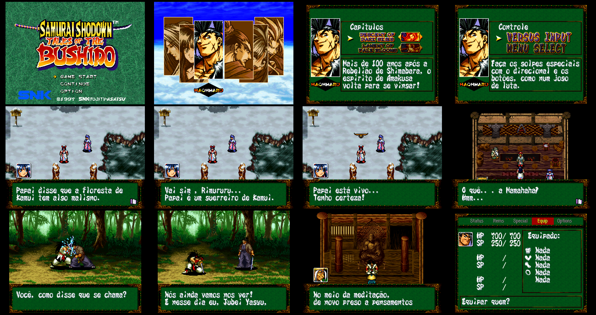

# Samurai Shodown RPG (Neo Geo CD) — tradução PT-BR (beta)

Tradução para português brasileiro de **Samurai Shodown RPG** (Shinsetsu Samurai Spirits Bushidō Retsuden, SNK, 1997, Neo Geo CD), feita **sobre a tradução em inglês v1.10** de moriyamug (texto) e combustocrat (arte).

## Baixar o patch
Na página de [Releases](https://github.com/anondaniel/SamuraiShodownRPG-PTBR/releases), ou direto na pasta [`patch/`](patch/): `SSRPG_PTBR_beta1.xdelta` + `LEIAME.txt` (passo a passo e hashes) + `.bat`.

Este repositório **não contém o jogo nem o patch em inglês**. Use o seu dump Redump e aplique primeiro o patch em inglês v1.10 (romhacking.net); os autores pedem que não se distribuam versões já aplicadas.

| Faixa 1 (`... (Track 01).bin`) | CRC32 |
|---|---|
| Original (Redump) | `6D0FAABA` |
| Depois do patch em inglês v1.10 | `7AB83E03` |
| Depois deste patch (PT-BR beta 1) | `4DB01EAD` |

## O que está traduzido (beta 1)
- Toda a história (todos os diálogos), com acentos.
- Seleção de personagem e capítulo, controle, save/load, lojas, ferreiro, itens, equipamentos, efeitos e lugares.
- Ainda em inglês: mensagens de luta, inimigos, introdução, algumas artes de menu. Os nomes dos golpes ficam em inglês de propósito.
- Extra: START liga e desliga as lutas aleatórias no mapa.

Testado no MAME e no Nintendo Switch (RetroArch, núcleo NeoCD).

## Ferramentas
- `ferramentas/iso_para_bin.py`: converte uma ISO (2048) em faixa MODE1/2352 com EDC/ECC, igual à do Redump.

Créditos: tradução e hacking — Daniel Figueira (anondaniel). Tradução em inglês v1.10 — moriyamug (texto) e combustocrat (arte). Jogo original — SNK.
